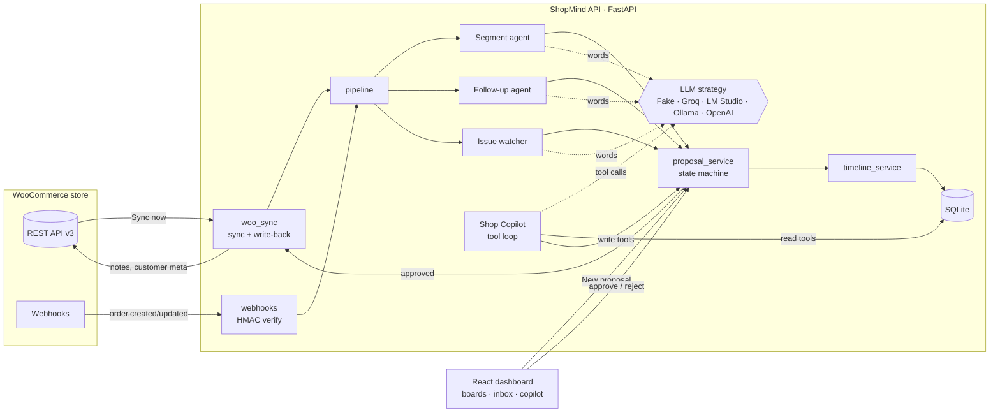

# ShopMind — Architecture, scope and design

ShopMind is a CRM layer that sits beside a WooCommerce store. It keeps a clean
customer record, tracks every order, and runs AI agents that **propose**
customer communication and CRM changes. A human approves each proposal before
anything changes, and approved actions are written back into WooCommerce.

## 1. Scope

The Kilowott brief asks for a CRM that integrates with WooCommerce, covering customer data management, order tracking and communication workflows.

| Brief item | What ShopMind does | Where |
|---|---|---|
| Customer data management | Customers are created and merged from orders. Matching is by email and phone, so guest checkouts join the right person. Each customer gets segments (New, Regular, VIP, At Risk), lifetime spend, an order count and a full timeline. | `services/customer_service.py`, `agents/segment_agent.py`, Customers board |
| Order tracking | Orders come in by REST sync (backfill) and signed webhooks (real time). Status changes are tracked, and failed payments and repeated refunds or cancellations are detected. | `services/woo_sync.py`, `routes/webhooks.py`, `agents/issue_watcher.py`, Orders board |
| Communication workflows | The follow-up agent drafts emails after order events. You can also write one by hand or ask the Copilot. Once approved, the email becomes a WooCommerce customer note, and WooCommerce emails it to the customer. | `agents/follow_up_agent.py`, `services/manual_proposal.py`, write-back |
| Integration (two-way) | WooCommerce REST API v3 and webhooks feed into ShopMind. Approved actions flow back out as order notes and customer meta. | `woo_client.py`, `services/woo_sync.py` |
| Agentic AI | The Shop Copilot runs a tool-calling loop over 8 CRM tools. Its write tools can only create pending proposals. | `agents/copilot.py`, `agents/copilot_tools.py` |

**Out of scope (on purpose, given 4 hours):** product and catalogue management (that's the PIM track),
user accounts and roles (one admin), sending email over SMTP (WooCommerce's
own mailer does it through customer notes), multi-store, and payments.

## 2. Assumptions

- Rules make every decision, and the LLM only writes the words: the segment, whether to follow up and the issue type come from plain Python rules, which can be tested. The LLM gets those facts as JSON and writes the explanation or email. It is told not to invent prices, discounts or order details.
- Nothing changes without a human. Agents and the Copilot can only create pending proposals, and no tool can approve.
- Provenance is honest. Each proposal records `agent_name` (rules agent, `shop_copilot` or `manual`), `is_llm_generated`, and the model that actually answered. A fallback template is never labelled as LLM output.
- The store is Indian, so all amounts are in ₹ with en-IN formatting, and the VIP threshold is ₹15,000 lifetime spend.
- Free to run: the default LLM is the offline `FakeLLM`. Groq's free tier, LM Studio and Ollama are free real options, and OpenAI is optional.
- WooCommerce is the source of truth for orders, and ShopMind is the source of truth for CRM state (segments, proposals, timeline).

## 3. Components

### Life of an order

1. WooCommerce fires `order.updated`, and the webhook checks the base64 HMAC-SHA256 signature. Unsigned or wrongly signed calls get a 401.
2. `process_payload` upserts the customer and the order. Agents run only when the order is new or its status changed, so a re-sync is idempotent.
3. The rules decide, for example, "payment failed, so this is an order issue". The LLM writes the explanation, and a pending proposal is stored with a `dedup_key` so it can't be duplicated.
4. The Approval Inbox shows it. Every board refreshes on a `shopmind:changed` event and every 15 seconds.
5. On approve, ShopMind executes the action locally (for example, a segment change), writes it back to WooCommerce, and logs the result on the timeline.

## 4. Design patterns

| Pattern | Where | Why |
|---|---|---|
| Strategy | `agents/llm.py`: `LLMClient` protocol, with `get_llm()` choosing Fake, Ollama, LM Studio, OpenAI or Groq from config | Change the model with one env var and no code changes |
| Decorator / fallback chain | `FallbackLLM(primary, FakeLLM)` | A down or slow model never breaks ingestion |
| Adapter | `WooCommerceClient` (REST, OAuth1 or Basic) and `payload_from_rest` | REST and webhook payloads become one internal schema |
| Null object / mock | `get_woo_client()` returns `None` in mock mode, plus `MockWooClient` | Runs offline with demo data, and the same code path serves both modes |
| Service layer | `services/*` hold the business logic; routes are thin | Easy to test without HTTP |
| State machine | `proposal_service`: pending → approved/rejected → executed, with guarded transitions | No double approvals and no executing a rejected card |
| Command / registry | `copilot_tools.Tool` dataclass + registry; each tool has a JSON schema | The LLM sees exactly the allowed actions, and writes are flagged |
| Idempotency key | Unique `Proposal.dedup_key`, plus a status-change check on sync | Retries and re-syncs don't create duplicates |
| Audit log (event log) | `timeline_service.record_event` on every state change and write-back | A full history for every customer |
| Dependency injection | FastAPI `Depends(get_db)`, overridden in tests | Tests use an isolated database |
| Observer (frontend) | `notifyDataChanged()`, a `shopmind:changed` window event, and `useApi` refetch | Copilot, approvals and sync keep every view current |

## 5. Testing strategy

| Layer | What | Count | Command |
|---|---|---|---|
| Backend unit + integration | Rules, agents, LLM providers (httpx mocked), webhook signatures, sync, write-back, Copilot loop, manual proposals, API via TestClient | 149 | `cd backend && pytest tests` |
| End-to-end | Starts the real API and a fake WooCommerce store as two uvicorn processes, then drives the whole loop over HTTP: connect, sync, idempotent re-sync, signed and unsigned webhooks, failed-payment issue, approve → write-back, reject → nothing written, Copilot → pending only | 18 | `cd backend && pytest e2e` |
| Frontend unit | Rupee formatting and helpers; New proposal form behaviour (validation, payloads, errors) with Testing Library | 12 | `cd frontend && npm test` |
| CI | GitHub Actions runs all of the above, plus the production build and the Docker image build, on every push and PR | | `.github/workflows/ci.yml` |

## 6. Operations

- **One command:** `docker compose up --build` starts the API on :8000 and the dashboard on :3000. On first start it uses demo data and the offline LLM, so no keys are needed.
- **Configuration:** everything uses `SHOPMIND_*` env vars in `backend/.env` (see `.env.example`): LLM provider and keys, WooCommerce mode, URL and keys, the webhook secret, and write-back on or off.
- **Health:** `GET /health` reports the LLM provider and whether it's reachable. `GET /api/woocommerce/status` checks the store credentials.
- **Failure behaviour:** if the LLM is down, it falls back to templates. If WooCommerce write-back fails, the error goes on the timeline and the approval still executes. If one order fails during a sync, it's reported in `errors` and the rest continue. Hosted LLM 429 responses are retried using `retry-after`.
- **Security:** webhooks need a valid signature (debug mode is off by default). Keys stay in `.env`, which is git-ignored. CORS is limited to the dashboard origins.
- **Known limits:** SQLite with a single writer (fine for one store; Postgres would be a URL change), no auth on the dashboard, and email delivery depends on WooCommerce's mailer.
